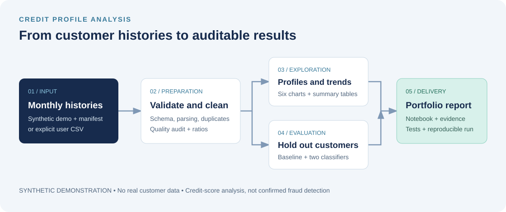
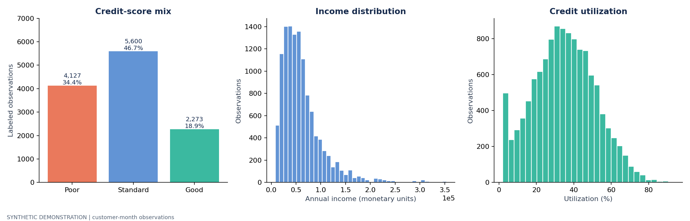
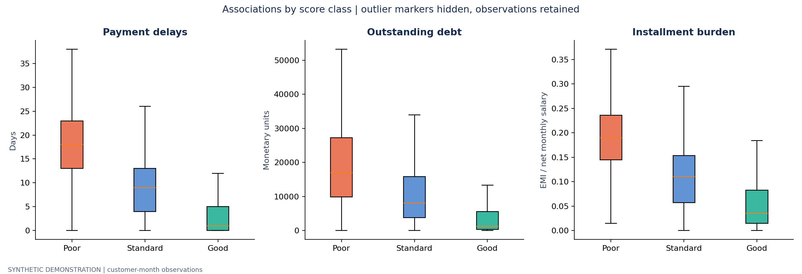
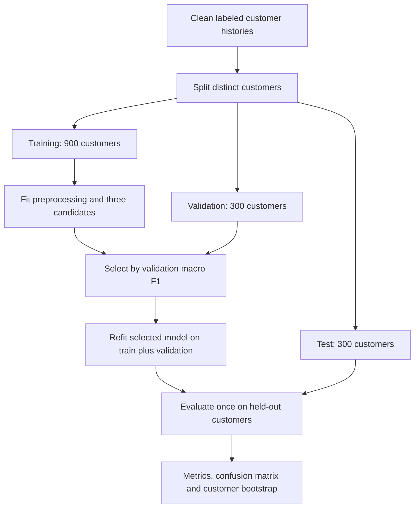

# Credit Profile Analysis
### Paisabazaar case study · reproducible EDA and model evaluation

[](https://github.com/Krishna0659/EDA_Project_Analysis-/actions/workflows/ci.yml)


An end-to-end portfolio project that turns monthly credit profiles into a data
quality audit, six visual analyses and a customer-separated classification
experiment. It extends [VenkyAdi's original notebook](PROVENANCE.md) with runnable
code, tests, documented assumptions and reproducible results.

**The original dataset was not included upstream. This repository uses newly
generated synthetic data, with plausible but deliberately designed relationships.
It contains no real Paisabazaar customer data.** The inherited project name says
“fraud,” but the available target is credit score; fraud is not measured here.

**Explore:** [Completed notebook](notebooks/credit_profile_analysis.ipynb) ·
[Full analysis report](reports/demo/REPORT.md) · [Data dictionary](docs/DATA_DICTIONARY.md) ·
[Methodology](docs/METHODOLOGY.md)

## Project at a glance

| Area | Delivered |
| --- | --- |
| Dataset | 1,500 synthetic customers × 8 months; 12,024 input rows including 24 duplicates |
| Preparation | Schema checks, numeric parsing, domain validation, missingness audit and two financial ratios |
| Exploration | Class balance, income, utilization, payment/debt profiles, correlations and monthly trends |
| Evaluation | Majority baseline, logistic regression and random forest; no customer overlap across partitions |
| Reproducibility | Seeded generation, input checksum, environment manifest, automated tests and GitHub Actions |
| Presentation | Executed notebook, illustrated report, workflow diagrams and source attribution |

## Workflow



## Results from the synthetic demonstration

| Held-out metric | Selected random forest | Majority baseline |
| --- | ---: | ---: |
| Accuracy | 0.688 | 0.445 |
| Balanced accuracy | 0.704 | 0.333 |
| Macro F1 | 0.687 | 0.205 |

The selected model's test macro-F1 customer-bootstrap interval is **0.664–0.710**.
There are **300 held-out customers / 2,400 test observations**. The model was
selected using validation macro F1, then refitted on training plus validation.
These results demonstrate the workflow on designed data; they do not establish
real-world predictive ability or business impact.



The cleaned demonstration contains 46.7% Standard, 34.4% Poor and 18.9% Good
customer-month labels. Payment delays, debt and utilization vary by class because
the generator deliberately connects them to latent financial stress. The
[report](reports/demo/REPORT.md) provides calculated comparisons and limitations.



## Run locally

Python 3.13 is the tested version. From this repository's root in **PowerShell**:

```powershell
py -3.13 -m venv .venv
.\.venv\Scripts\python.exe -m pip install -r requirements.txt -e ".[dev]"
.\.venv\Scripts\python.exe -m credit_analysis.pipeline --output reports/local
.\.venv\Scripts\python.exe -m pytest -q
```

Open `reports/local/REPORT.md` for the newly generated report. All six images,
aggregate CSV tables, quality audit, model metrics and a run manifest are saved
alongside it. The committed demonstration outputs are in `reports/demo/`.

On macOS/Linux, use `python3.13 -m venv .venv` and substitute
`.venv/bin/python` for `.\.venv\Scripts\python.exe`.

To regenerate the same dataset and execute the notebook:

```powershell
.\.venv\Scripts\python.exe -m credit_analysis.demo --seed 42 --customers 1500 --months 8
.\.venv\Scripts\python.exe scripts/execute_notebook.py
.\.venv\Scripts\python.exe -m jupyterlab notebooks/credit_profile_analysis.ipynb
```

The generator writes a CSV plus a metadata file declaring it synthetic and
recording its SHA-256. The analysis validates that checksum. Different seeds or
sample sizes require rerunning the analysis and updating any published results.

### Use a dataset you are authorized to analyze

Place the CSV in the ignored `data/raw/` directory and follow the
[input contract](docs/DATA_DICTIONARY.md#input-contract):

```powershell
.\.venv\Scripts\python.exe -m credit_analysis.pipeline --input data/raw/dataset.csv --data-kind user-provided --output reports/local
```

Numeric credit history defaults to **months**; pass `--history-unit years` when
the source documents years. Text such as `5 Years and 3 Months` is parsed directly.
The command stops on schema errors, missing customer IDs, conflicting
customer-month records or insufficient class coverage. It writes only aggregate
results. Review those results before sharing them.

## How leakage is controlled



Imputation and encoding are learned within training pipelines. IDs, customer
identifiers, names, SSNs, month and the target are excluded from predictors.
All months for a customer stay together. This protects the new-customer holdout;
it does not replace future-period validation or establish feature timing.

## Repository guide

```text
credit_analysis/       Generator, cleaning, evaluation and report pipeline
data/demo/             Synthetic CSV and provenance manifest
data/raw/              Ignored location for your own input data
notebooks/             Completed, executed portfolio notebook
reports/demo/          Reviewed synthetic results, tables and six figures
docs/                  Methodology, data dictionary and architecture diagram
tests/                 Cleaning, leakage, provenance and end-to-end checks
scripts/               Fresh-kernel notebook execution
.github/workflows/     Automated checks and report artifacts
Banking-Fraud-.../     Original attributed notebook (saved outputs cleared)
references/            Original repository overview
```

## Design choices and limits

- Retain unusual valid monetary values; flag invalid domains instead of applying
  undocumented global outlier deletion.
- Keep missing values visible in EDA; fit model imputation only on training data.
- Interpret debt/annual income as a stock-to-income ratio and EMI/net salary as
  installment burden. Currency is unspecified; neither ratio is full underwriting DTI.
- Report associations without causal claims. Monthly records repeat customers.
- Synthetic labels are designed from related features and noise. Real data,
  outcome timing, calibration, subgroup evaluation and drift checks are needed
  before drawing operational conclusions.

## Verification

- **20 automated tests passed**, covering cleaning, invalid inputs, customer
  separation, training-only imputation, provenance and complete report generation.
- **All 10 notebook code cells executed** without errors in a fresh kernel.
- A [clean GitHub Actions run](https://github.com/Krishna0659/EDA_Project_Analysis-/actions/runs/41317221808)
  installed the recorded dependencies on Linux, reran the tests and full analysis,
  executed the notebook, and uploaded the generated reports.
- Six charts and the architecture diagram were visually reviewed; local
  documentation links were checked.

## Attribution

Original EDA reference: **VenkyAdi / EDA---Projects**, pinned at
`7c247fe85517d0603572556afaecee72ab775db2`.
This repository's new implementation and presentation are maintained under
**Krishna0659**. See [PROVENANCE.md](PROVENANCE.md) for source details and the
upstream license-status note. The project is an independent portfolio exercise;
no affiliation with Paisabazaar is claimed.
