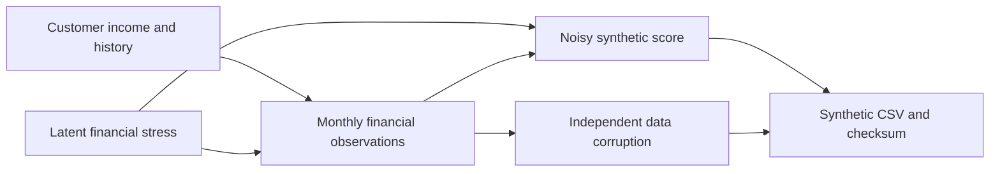

# Methodology and experiment design

## Purpose

Demonstrate reproducible exploratory analysis of credit profiles and a carefully
partitioned classification experiment. The inherited folder name mentions fraud,
but the target is Credit_Score. Neither confirmed fraud nor loan-default outcomes
are available. No claim about fraud-detection or default reduction follows.

## Synthetic population

The seed-42 demonstration contains 1,500 customers, eight monthly observations per
customer and 24 duplicate rows, totaling 12,024 input records. The distribution
is designed to be plausible, not calibrated to a real institution or country.

1. Draw adult ages, right-skewed annual income, customer-specific financial stress,
   account counts, loan counts, and credit history.
2. Repeat stable customer attributes across months. Allow small income growth,
   declining debt balances and monthly variability in utilization and payments.
3. Connect higher latent stress with higher utilization, delays, interest rates,
   installment burden and minimum-only payments. Net salary is a fraction of
   annual income divided by 12. Balances subtract expenses, investments and EMIs.
4. Generate three noisy score classes using stress, delays, utilization, credit
   history, an unobserved customer effect and fresh monthly noise.
5. Inject missing fields, trailing underscores, placeholder categories, invalid
   ages and exact duplicates, independently of target class.

The model is learning relationships deliberately introduced by the generator.
Reasonable-looking accuracy is not validation against real-world credit risk.
There are no real names or SSNs. Occupations and loan descriptions are illustrative.

## Cleaning and EDA

Cleaning is deterministic and row-local: parse known numeric formats, normalize
placeholders, validate domains, remove exact duplicates and derive ratios.
Invalid values become missing and are counted. EDA uses observed values and
reports missingness; it does not impute or discard unusual valid incomes.

Credit-history months are checked against age in months where age is known.
The original notebook's recorded numeric history unit cannot be established from
its metadata, so users must confirm units for a replacement dataset.

Class distributions use labeled-row denominators. Medians exclude missing values
per variable. Correlations are Spearman rank correlations with pairwise complete
observations. Boxplots hide outlier markers for readability but preserve all
rows in their underlying calculations. Monthly score shares are descriptive,
and repeated customer-month records are not independent observations.

Debt divided by annual income is a stock-to-income ratio, not the proportion of
monthly income spent repaying debt. EMI divided by net monthly salary represents
only the modeled installment burden and excludes other obligations.

## Evaluation

Customer groups are split 60% training, 20% validation, 20% test using fixed seeds
42 and 43. All months for a customer stay together. This is a new-customer
experiment within one period; it is not a chronological backtest.

The preprocessing pipeline fits median numeric imputation, missing indicators,
numeric standardization, constant categorical imputation and one-hot encoding on
training rows only. Unknown test categories are accepted. IDs, customer IDs,
names, SSNs, month, free-text loan descriptions and Credit_Score are excluded.

Three candidates use the same partitions: majority-class baseline, balanced
logistic regression and a 160-tree random forest with maximum depth 12 and a
minimum of five rows per leaf. Validation macro F1 chooses the candidate, which
is then fitted on training plus validation rows. Test metrics are computed once
for the selected model and the refitted majority baseline.

Metrics include accuracy, balanced accuracy, macro F1, per-class precision and
recall, and the confusion matrix. A 200-repeat customer-level bootstrap estimates
a percentile interval for holdout macro F1 while preserving each sampled
customer's monthly observations. It holds the fitted model fixed and does not
measure retraining uncertainty.

## Scope of the results

Predictors and labels are contemporaneous in this demonstration. Credit_Mix and
related variables could be derived from the same assessment as Credit_Score in a
real dataset. Customer separation alone does not solve this label-timing problem.
Before deployment, establish source lineage, feature availability at decision
time, future-period validation, calibration, subgroup performance and drift.
No model is serialized or deployed for lending decisions in this project.

## Reproducibility

The dataset manifest records its SHA-256, generation seed and dimensions. The
analysis checks the manifest before using the demo and records input SHA-256,
Python version and package versions. Synthetic metadata cannot be overridden by
calling the data user-provided. Git enforces LF line endings for CSV so the
checksum remains portable across Windows and Linux.

The published environment is Python 3.13 with direct runtime versions in
`requirements.txt`. Floating compatible ranges in `pyproject.toml` support normal
installation; use both files for the recorded demonstration environment. Small
floating-point or chart-rendering differences can occur across systems.
