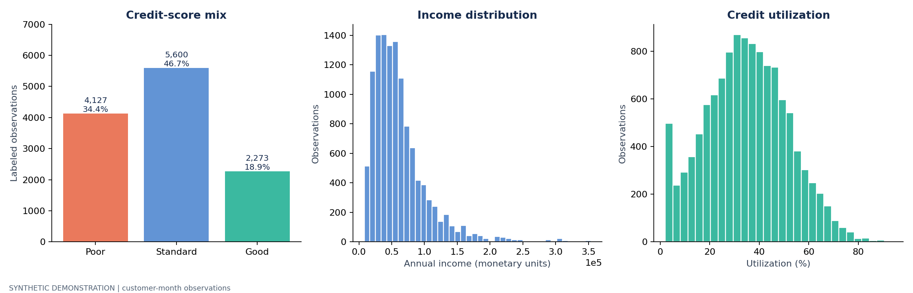
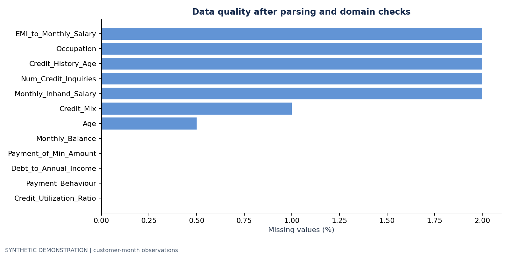
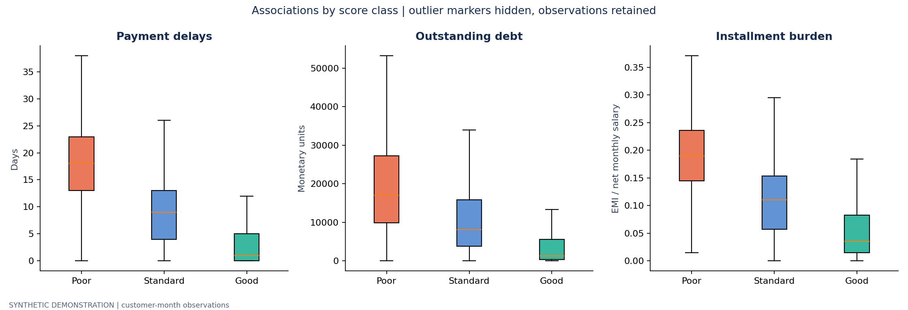
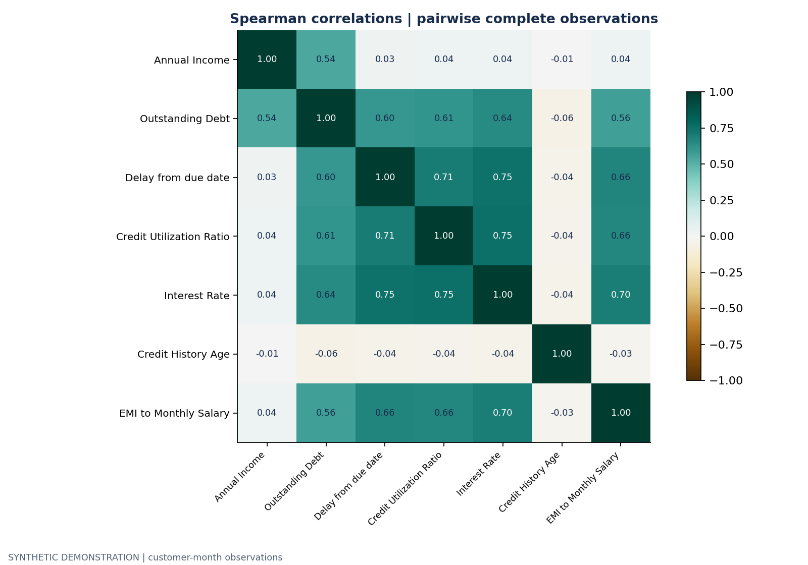
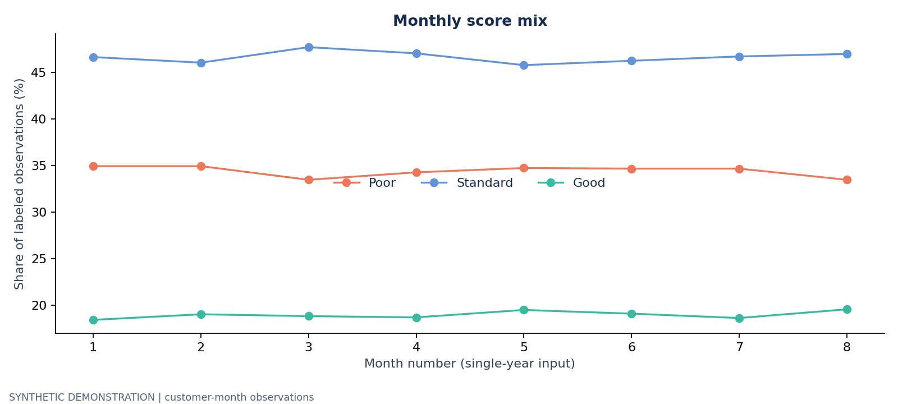
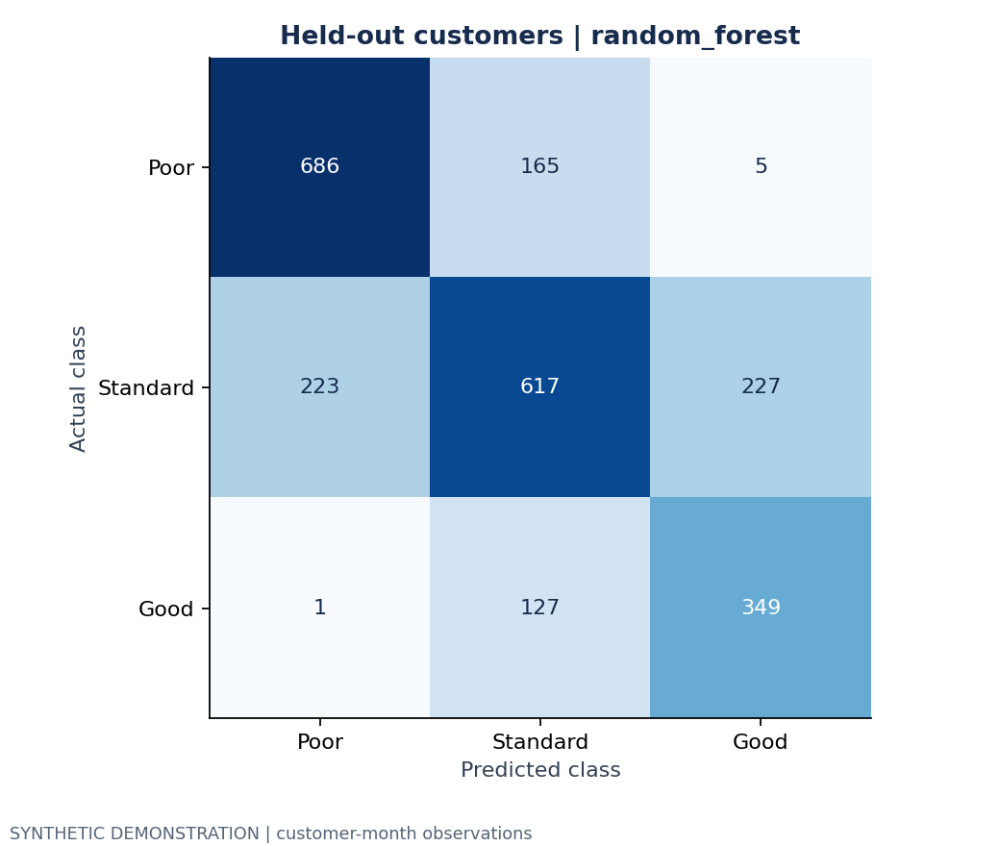

# Credit-profile analysis: Synthetic demonstration

**Data status: SYNTHETIC.** All patterns and performance below come from generated data. They are not findings about real customers or Paisabazaar.

## Dataset and quality

- Input: **12,024 rows**; **24 exact duplicates** removed.
- Analysis: **12,000 customer-month observations**, **1,500 customers**.
- Unlabeled rows: **0** (excluded from score comparisons and modeling).
- Missing feature cells after cleaning: **1,380**; EDA uses available observations.
- Parsing failures and invalid values are set to missing and counted in `data_quality.json`.
- Original monetary outliers remain; no global clipping, mean filling, or label-dependent cleaning.

| Score | Observations | Share of labeled rows (%) |
| --- | --- | --- |
| Poor | 4127 | 34.392 |
| Standard | 5600 | 46.667 |
| Good | 2273 | 18.942 |

## Descriptive observations

- Median delay: **18.0 days** for Poor versus **1.0 days** for Good.
- Median utilization: **47.8%** for Poor versus **17.1%** for Good.
- Median outstanding debt: **17,006** versus **1,277 monetary units**, respectively.

These summaries weight each customer-month equally. Repeated observations are
not independent customers. No causal or population-significance claim is made.
For the synthetic demo, the relationships are intentionally introduced by the generator.

`Debt_to_Annual_Income` is outstanding debt divided by annual income, a stock-to-income
ratio. `EMI_to_Monthly_Salary` is monthly installments divided by net monthly salary.
Neither is a complete underwriting debt-to-income measure. Currency is unspecified.

## Model experiment

Customers are separated into train/validation/test groups (60/20/20 by customer).
Imputation, scaling and category encoding are fitted only on training rows during
selection. Validation macro F1 selects the model; it is refitted on train plus
validation before a single test-set evaluation. Direct identifiers, month,
loan-description text and the target are excluded from predictors.

| Model | accuracy | balanced_accuracy | macro_f1 |
| --- | --- | --- | --- |
| majority_baseline | 0.463 | 0.333 | 0.211 |
| logistic_regression | 0.684 | 0.710 | 0.684 |
| random_forest | 0.698 | 0.693 | 0.693 |

- Selected model: **random_forest**.
- Held-out accuracy: **0.688**.
- Held-out balanced accuracy: **0.704**.
- Held-out macro F1: **0.687**.
- Majority baseline test macro F1: **0.205**.
- Customer-bootstrap 95% interval for test macro F1: **0.664–0.710** (200 resamples; fixed fitted model).
- Customer overlap across partitions: **0**.

The interval describes test-customer sampling variability for this fitted model;
it does not capture retraining variability or generator-to-world differences.
This split estimates new-customer performance within the same period, not future
performance. Contemporaneous credit attributes may encode the score itself.

## Conclusion and next steps

The project demonstrates an auditable EDA and model-evaluation workflow. Real
data is needed to establish any customer insight or business value. Before using
it beyond a portfolio exercise: verify data rights and units, define label timing,
check whether predictors precede outcomes, evaluate a future-period holdout,
assess subgroup performance and calibration, and review missingness and drift.
The dataset has no confirmed fraud target or default outcome, so fraud-detection
accuracy, default reduction and lending recommendations cannot be measured here.
